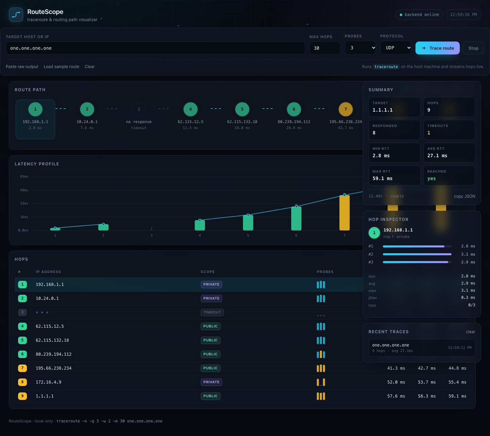
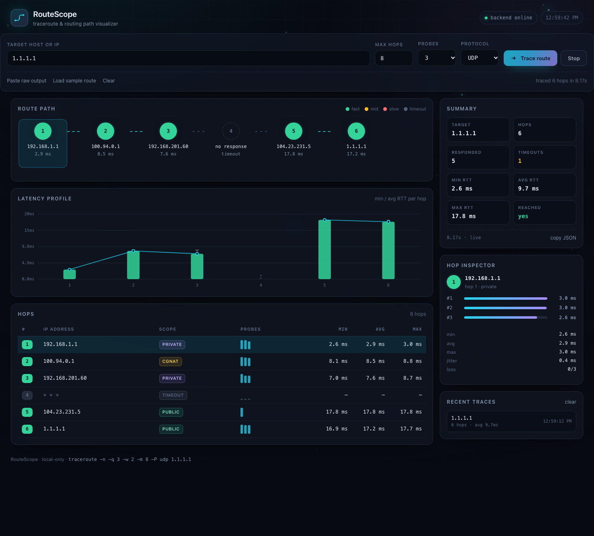
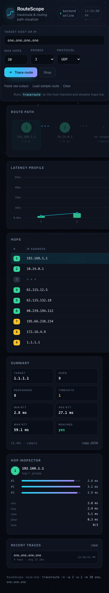

# RouteScope — traceroute / routing visualizer

A local webapp that runs `traceroute` on your machine and streams the hops into a
live visual UI: route rail, latency profile chart, hop table, inspector and history.

Zero dependencies — just Node (>=18) and the system `traceroute` binary.

```bash
cd new-terms
npm start          # or: node server.js
# -> http://127.0.0.1:4180
```

Port is `4180` by default. Override with `PORT=4181 npm start`.

## Screenshots

Sample route (`/?demo=1`) — route rail, latency profile, hop table, summary and inspector:



Live trace against `1.1.1.1` streamed hop by hop, with real scope badges
(CGNAT / private / public):



Narrow viewport — the layout collapses to a single column:

<p align="center">
  
</p>

All shots were captured with headless Chromium at 1440×1281 and 430×2314.

## Features

- **Animated route backdrop** — canvas topology of drifting router nodes, proximity links and
  packets tracing multi-hop paths; DPR-aware, paused on hidden tabs, static frame under
  `prefers-reduced-motion`.
- **Live streaming** — hops appear one by one over Server-Sent Events as traceroute probes them.
- **Route rail** — hop nodes colour-coded by RTT tier (fast / mid / slow / timeout) with animated flow edges.
- **Latency profile chart** — min–max whisker + avg bars + avg polyline per hop, gaps where probes timed out.
- **Hop table** — IP, address scope badge (public / private / CGNAT / loopback / link-local / multicast / reserved), per-probe sparkline, min/avg/max.
- **Hop inspector** — per-probe RTT bars, loss count, jitter.
- **Summary** — hop count, responded, timeouts, min/avg/max RTT, target reached, duration.
- **Paste mode** — visualize output of any existing `traceroute` dump without running anything.
- **Sample route** — offline demo data (`?demo=1`).
- **Deep links** — `/?host=example.com&maxHops=20` auto-runs a trace on load.
- **Recent traces** — last 8 targets in `localStorage`, click to re-run.
- **Copy JSON** — full trace payload to the clipboard.

## HTTP API

| Endpoint | Description |
| --- | --- |
| `GET /api/health` | `{ ok, traceroute, platform }` |
| `GET /api/trace` | Full JSON result after the trace completes |
| `GET /api/trace/stream` | SSE: `header`, `hop` (one per hop), `done`, `failed` |

Query params: `host` (required), `maxHops` (1–64, default 30), `probes` (1–5, default 3),
`timeout` (1–5s, default 2), `protocol` (`udp` \| `icmp` \| `tcp`).

```bash
curl -s "http://127.0.0.1:4180/api/trace?host=1.1.1.1&maxHops=5" | jq .
curl -sN "http://127.0.0.1:4180/api/trace/stream?host=example.com" | head
```

## Notes

- Host input is validated (`^[a-zA-Z0-9._:\-\[\]]+$`, no leading `-`) and passed to
  `spawn` as an argv array — never through a shell.
- Static file serving is confined to `public/` (path traversal returns 404/403).
- On macOS the traceroute banner is written to **stderr** when stdout is not a TTY;
  the server parses both streams.
- `ICMP`/`TCP` modes may need elevated privileges depending on the platform — the
  traceroute error is surfaced in the UI as a toast.
- Abort a running trace with **Stop** or `Esc`; the child process is killed (`SIGTERM`).

## Layout

```
new-terms/
├── server.js            # static server + traceroute runner + SSE
├── package.json
└── public/
    ├── index.html
    ├── styles.css
    ├── background.js    # animated routing-topology canvas backdrop
    └── app.js           # rendering, parsing, streaming client
```

# tracerouting
